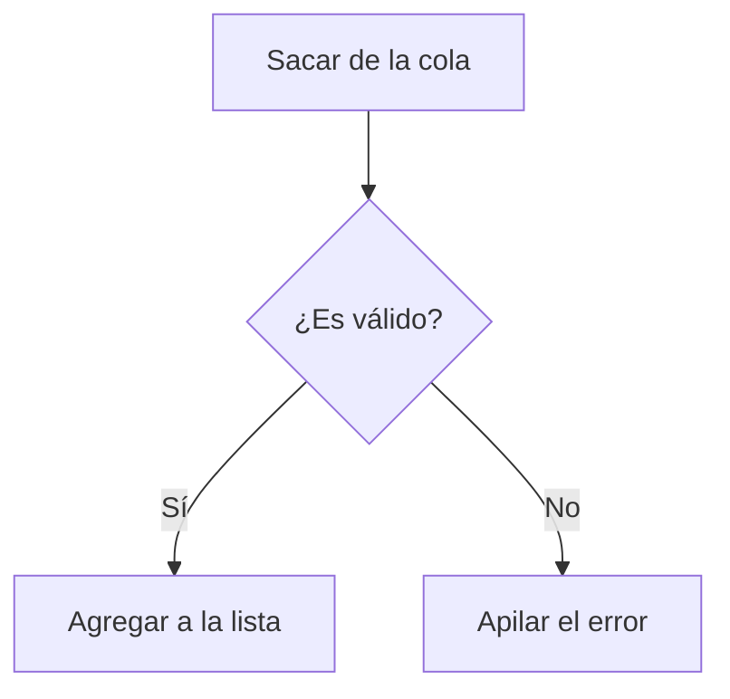

# Josue — Bitácora, flujogramas, prompts e informe

**Tu rama:** `rama--Josue`

Este archivo tiene todo lo que haces en el proyecto, de principio a fin. Léelo completo una vez y después ve parte por parte.

## Qué te toca, en simple

Tú construyes la parte que le permite al programa **contar lo que hizo**.

- La **bitácora** anota los pasos de un proceso mientras ocurre.
- Con esos pasos se dibuja un **flujograma**.
- Con los números del proceso se arma el **prompt**, el texto que se le envía a la IA para que redacte el reporte.
- Y guardas las **evidencias** de todo lo que se le pidió a la IA, además del informe.

Es la parte con más puntos de la rúbrica (1,50 de 10). Esta vez tienes código propio, no solo documentación: es lo que el docente va a ver en GitHub.

Un **flujograma en Mermaid** es un dibujo que se escribe como texto. GitHub lo dibuja solo cuando está dentro de un archivo `.md`. Por ejemplo, este texto:

````

````

se ve en GitHub como un diagrama con una caja, un rombo y dos salidas.

## Tu camino completo

| Parte | Qué creas | Cuándo | Qué necesitas de otros |
| --- | --- | --- | --- |
| 1 | `Bitacora` | Sábado | Nada |
| 2 | Tabla de transiciones | Sábado | Nada |
| 3 | `GeneradorFlujograma` | Domingo | Nada |
| 4 | `GeneradorPrompt` del reporte | Domingo | `ResumenETL` de Sara |
| 5 | El "oyente" para las estructuras | Después | Acuerdo con todos |
| 6 | Flujograma del ETL | Después | ETL integrado |
| 7 | Prompts de los demás diagramas y explicaciones | Después | Estructuras avisando sus pasos |
| 8 | Evidencias | Siempre | Respuestas de la IA |
| 9 | Informe, diagrama de clases y README | Al final | Todo |

## Con quién se conecta tu trabajo

- **Sara** te da el `ResumenETL` con los números del proceso; con él armas el prompt del reporte.
- **Damian** recibe tu prompt en su `AnalizadorIA`, que lo envía a Gemini y trae la respuesta.
- **Todos** usan tu bitácora: la cola de Joel, la pila de Kenneth, el árbol de Damian, el `Transform` de Luis avisan sus pasos a tu bitácora.
- **Sara** conecta tus generadores al menú.

## Antes de empezar

- Ten el repo clonado y tu rama al día con `main` (los comandos están al final).
- Abre `src/estructuras/ListaEnlazada.java`: tu bitácora guarda sus eventos en esa lista.
- Abre `test/PruebaListaEnlazada.java`: tus pruebas siguen ese estilo.
- Escribe a mano un diagrama Mermaid pequeño en un `.md`, súbelo a tu rama y míralo en GitHub, para ver cómo se dibuja.

---

## Parte 1 — La bitácora (`src/ia/Bitacora.java`)

**Qué creas:** dos clases en el paquete nuevo `ia`.

**`Evento`**, una clase pequeña con atributos `final`, constructor y getters:

- `numero`: el orden del paso (1, 2, 3…);
- `proceso`: a qué pertenece (`ETL`, `COLA`, `PILA`, `BST`, `BFS`, `DFS`);
- `accion`: qué pasó, en una palabra clave (`ENCOLAR`, `VALIDAR`, `APILAR_ERROR`…);
- `detalle`: los valores reales (por ejemplo "FIPS 01001, línea 25").

**`Bitacora`**, que guarda los eventos en una `ListaEnlazada<Evento>`:

| Método | Qué hace |
| --- | --- |
| `void registrar(String proceso, String accion, String detalle)` | Anota un evento. Solo si está activa y no llegó al tope |
| `void activar()` y `void desactivar()` | Encienden y apagan el registro |
| `boolean estaActiva()` | |
| `int tamanio()` | Cuántos eventos hay |
| `void limpiar()` | Borra todo para empezar otra corrida |
| `ListaEnlazada<Evento> eventos()` | Devuelve los eventos para recorrerlos |

**El tope.** La bitácora tiene un máximo de eventos (por ejemplo 200, definido al crearla). Al llegar al tope, deja de anotar.

**Por qué se enciende y se apaga.** Con la base real pasan más de un millón de registros por el ETL; anotar cada paso serían millones de eventos. La bitácora se enciende solo para corridas pequeñas: los datos de prueba, una inserción en el árbol, un recorrido desde un condado.

**Pruebas (`test/PruebaBitacora.java`):**

1. Bitácora nueva: tamaño 0.
2. Activa, registrar un evento: tamaño 1 y los datos del evento son los que se enviaron.
3. Los números de paso van en orden: 1, 2, 3.
4. Apagada, registrar: el tamaño no cambia.
5. Con tope de 5, registrar 8: el tamaño queda en 5.
6. `limpiar()` deja el tamaño en 0 y el siguiente evento vuelve a ser el número 1.

## Parte 2 — La tabla de transiciones

**El problema.** Una lista de 200 eventos no es un flujograma. Si se dibuja un evento tras otro, sale una fila de 200 cajas sin decisiones. Hay que **resumir**.

**La idea:** fijarse en qué acción vino después de cuál, y cuántas veces.

Ejemplo. Si la bitácora tiene estos eventos:

```
DESENCOLAR, VALIDAR, AGREGAR_A_LISTA,
DESENCOLAR, VALIDAR, APILAR_ERROR,
DESENCOLAR, VALIDAR, AGREGAR_A_LISTA
```

la tabla de transiciones es:

| De | A | Veces |
| --- | --- | --- |
| DESENCOLAR | VALIDAR | 3 |
| VALIDAR | AGREGAR_A_LISTA | 2 |
| VALIDAR | APILAR_ERROR | 1 |
| AGREGAR_A_LISTA | DESENCOLAR | 1 |
| APILAR_ERROR | DESENCOLAR | 1 |

De ahí sale todo el diagrama:

- **Los pasos** son las acciones distintas (4 en el ejemplo).
- **Las flechas** son las filas de la tabla.
- **Las decisiones** son las acciones con más de una salida: `VALIDAR` va a dos lugares, así que es un rombo.
- **Las repeticiones** aparecen solas: hay flechas que vuelven a `DESENCOLAR`.

**Qué creas:**

- `Transicion`: una clase pequeña con `origen`, `destino` y `veces`.
- Un método que recorre los eventos de la bitácora y devuelve una `ListaEnlazada<Transicion>`. Por cada par de eventos seguidos: si esa transición ya está en la lista, le suma 1; si no, la agrega. Son pocas decenas de transiciones, así que buscar en la lista es suficiente.

**Prueba:** con los nueve eventos del ejemplo, la tabla tiene exactamente esas cinco filas con esas cantidades. Bitácora vacía o con un solo evento: tabla vacía.

**Pasos y commits del sábado:**

1. `Evento`, `Bitacora` y `PruebaBitacora`.
   Commit: `Bitacora: registro de eventos con prueba`
2. `Transicion`, la tabla de transiciones y su prueba.
   Commit: `Bitacora: tabla de transiciones`

**Al terminar el sábado:** abre tu Pull Request a `main`. El sábado no dependes de nadie.

---

## Parte 3 — El generador de flujogramas (`src/ia/GeneradorFlujograma.java`)

**Qué es:** una clase que convierte la tabla de transiciones en texto Mermaid, **sin usar la IA**.

**Por qué existe, si el enunciado pide IA:**

1. **Respaldo:** la demostración no puede depender del internet del aula.
2. **Control:** permite comparar el diagrama de la IA con lo que el programa sabe que pasó. Si la IA dibuja un paso que no está en la tabla, lo inventó.
3. Demuestra que el grupo entiende el proceso.

No reemplaza a la IA: deben existir los dos caminos.

**Qué hace, paso a paso:**

1. Escribe la primera línea: `flowchart TD`.
2. Por cada acción distinta, escribe un nodo. Si la acción tiene **una** salida, es una caja: `A[Texto]`. Si tiene **más de una**, es un rombo: `A{Texto}`.
3. Por cada transición, escribe una flecha con la cantidad: `A -- 3 veces --> B`.
4. Devuelve todo como un texto.

Cada nodo necesita un identificador corto sin espacios (puedes usar `N1`, `N2`…) y un texto legible.

**Y un segundo método** que escribe el archivo `.md` completo en `output/diagramas/`, con:

- un título;
- la fecha y la hora en que se generó;
- **de dónde salió**: generador propio, Gemini automático o Gemini manual;
- el bloque Mermaid (entre las líneas ` ```mermaid ` y ` ``` `);
- un párrafo que explique el diagrama.

**Pruebas (`test/PruebaGeneradorFlujograma.java`):** con la tabla del ejemplo, el texto empieza con `flowchart TD`, tiene los cuatro nodos, `VALIDAR` es un rombo y las demás son cajas, y hay cinco flechas.

**La prueba que más importa:** sube el `.md` a tu rama y míralo en GitHub. Si no se dibuja, hay un error en el texto.

## Parte 4 — El generador de prompts (`src/ia/GeneradorPrompt.java`)

**Qué es un prompt:** el texto con la instrucción y los datos que se le envían a la IA.

**Qué creas:** una clase que arma ese texto. El primero es el del **reporte del ETL**.

**Un buen prompt tiene tres partes:**

1. **La tarea.** Qué debe hacer la IA: "Redacta un reporte del proceso de limpieza de datos y genera un flujograma Mermaid del proceso".
2. **Los datos.** En formato fijo y claro:
   - los números del `ResumenETL` de Sara: leídos, válidos, reparados, advertencias, rechazados y rechazados por motivo, para cada archivo;
   - la tabla de transiciones de una corrida pequeña.
3. **Las condiciones.** Cómo debe responder: en español; sin cambiar ninguna cifra; sin inventar pasos que no estén en la tabla; el diagrama dentro de un bloque Mermaid que empiece con `flowchart TD`.

**Qué hace la clase:**

- un método que recibe el `ResumenETL` y la lista de transiciones, y devuelve el prompt como texto;
- el texto fijo (tarea y condiciones) se guarda en un archivo de **plantilla** dentro del repo, por ejemplo `prompts/reporte_etl.txt`. Las plantillas son evidencia: muestran qué se le pide a la IA.

**Lo que nunca va en el prompt:** los registros. Solo el resumen. Es más barato, la respuesta es mejor y es lo que pide el enunciado.

**Prueba:** con un `ResumenETL` de números conocidos, el prompt contiene esos números y las condiciones.

**Pasos y commits del domingo** (primero pon tu rama al día con `main`):

3. `GeneradorFlujograma` con su prueba, y un diagrama de ejemplo que se dibuje en GitHub.
   Commit: `GeneradorFlujograma: Mermaid desde la bitacora`
4. `GeneradorPrompt` y la plantilla del reporte ETL.
   Commit: `GeneradorPrompt: prompt del reporte ETL`

**Al terminar:** abre el PR enseguida. Damian necesita tu prompt para cerrar el reporte con IA.

---

## Parte 5 — El "oyente": cómo avisan las estructuras

**El problema:** la cola de Joel debe poder avisar "encolé un dato" a tu bitácora, pero una cola no debería depender del paquete de IA. Debe seguir funcionando sola.

**La solución:** una interfaz pequeña, por ejemplo `OyenteEventos`, con un solo método: `evento(String proceso, String accion, String detalle)`.

- Tu `Bitacora` **implementa** esa interfaz: su `evento(...)` llama a `registrar(...)`.
- Cada estructura guarda un oyente opcional. Si tiene uno, le avisa; si no tiene, no hace nada.

**Tu trabajo:** crear la interfaz (ponla en `src/estructuras/`, para que las estructuras no dependan de `ia`), y acordar con cada compañero qué acciones avisa su clase:

| Clase | Dueño | Acciones |
| --- | --- | --- |
| `Cola` | Joel | `ENCOLAR`, `DESENCOLAR` |
| `Pila` | Kenneth | `APILAR`, `DESAPILAR` |
| `ListaEnlazada` | Kenneth | `INSERTAR`, `COMPARAR`, `ENLAZAR` |
| `ArbolBST` | Damian | `COMPARAR`, `IR_IZQUIERDA`, `IR_DERECHA`, `INSERTAR`, `ENCONTRADO` |
| `Transform` | Luis | `DESENCOLAR`, `VALIDAR`, `REPARAR`, `AGREGAR_A_LISTA`, `APILAR_ERROR` |
| `BFS` | Joel | `VISITAR`, `ENCOLAR_VECINO`, `VECINO_YA_VISITADO` |
| `DFS` | Kenneth | `DESAPILAR`, `VISITAR`, `APILAR_VECINO`, `YA_VISITADO` |

Cada uno agrega los avisos en su propia clase. Tú no tocas las clases de otros.

Commit: `OyenteEventos: interfaz para avisar pasos a la bitacora`

## Parte 6 — El flujograma del ETL

Es tu diagrama, y debe salir **de una ejecución real**:

1. Enciende la bitácora.
2. Ejecuta el ETL con los datos pequeños de `data/pruebas/`.
3. Saca la tabla de transiciones.
4. Genera el diagrama por los dos caminos: con tu generador propio, y con la IA (tu prompt, enviado por `AnalizadorIA`).
5. Guarda el resultado en `output/diagramas/etl.md`.
6. Compara los dos: todo paso y toda flecha del diagrama de la IA deben existir en la tabla.

El diagrama debe mostrar: la lectura, la cola, la transformación, la lista de válidos, la pila de errores y la carga.

Commit: `Flujograma del ETL generado desde la ejecucion`

## Parte 7 — Prompts de los demás diagramas y explicaciones

El enunciado pide **7 flujogramas**. Tú preparas las plantillas de prompt de todos; cada dueño genera el suyo:

| # | Diagrama | Archivo | Lo genera |
| --- | --- | --- | --- |
| 1 | ETL completo | `etl.md` | Tú |
| 2 | Cola | `cola.md` | Joel |
| 3 | Pila | `pila.md` | Kenneth |
| 4 | Lista enlazada | `lista.md` | Kenneth |
| 5 | Árbol | `bst.md` | Damian |
| 6 | BFS | `bfs.md` | Joel |
| 7 | DFS | `dfs.md` | Kenneth |

Además, tres plantillas de explicación:

- **Explicar el árbol** (Damian): número de nodos, altura, raíz y los primeros niveles.
- **Explicar el grafo** (Luis): vértices, aristas, grupos separados y la vecindad de un condado.
- **Analizar los errores** (Luis): solo la tabla de conteos por tipo.

En las tres, la condición es: "explica **esta** estructura usando sus valores, no la definición general".

Para el diagrama del grafo (un condado y sus vecinos), agrega a `GeneradorFlujograma` un método que reciba un condado y su lista de vecinos y escriba el Mermaid. **Nunca** el grafo completo: tiene más de 3.000 condados.

Commits: `Prompts: plantillas de los siete flujogramas` · `Prompts: explicacion de arbol, grafo y errores`

## Parte 8 — Las evidencias

El enunciado exige guardar la evidencia del uso de IA. Tú llevas el orden.

**Por cada uso de IA se guarda:**

- el prompt enviado (`output/ia/prompts/`);
- la respuesta recibida (`output/ia/respuestas/`);
- la fecha y el modelo usado;
- **qué se corrigió a mano y por qué** (por ejemplo: "la IA escribió 10.830 rechazados; el valor correcto es 10.803").

**Qué creas:** un archivo índice, `output/ia/INDICE.md`, con una fila por cada uso.

**También, con honestidad:** una sección que diga qué asistentes de IA usó el grupo durante el desarrollo y para qué (entender, revisar, probar). En la defensa preguntan "qué parte hizo la IA y qué parte hizo el equipo".

Y una línea que diga que los datos son públicos y están agrupados por condado: no hay información personal.

## Parte 9 — Informe, diagrama de clases y README

Cuando ya no se agreguen funciones:

- **README:** tiene datos viejos. Corrige los nombres de las ramas (las reales son `Kenneth_Chalco` y `rama--Josue`), los nombres de los archivos que lista, y reemplaza cualquier número "de memoria" por los que midió el programa. Agrega: cómo ejecutar, la estructura de carpetas, las decisiones del grupo y el índice de evidencias.
- **Diagrama de clases:** actualizado con todas las clases nuevas.
- **Informe:** el problema, los datos, el diseño, las tablas con los números medidos (ordenamiento, altura del árbol, búsqueda comparada), los 7 diagramas y las capturas que toma Sara.

---

## Errores comunes que debes evitar

- Dejar la bitácora encendida con la base real.
- Dibujar la lista completa de eventos en vez de la tabla de transiciones.
- Enviar registros a la IA.
- Aceptar un diagrama de la IA sin revisarlo: que empiece con `flowchart`, que se dibuje en GitHub y que cada paso exista en la tabla.
- Presentar como hecho por la IA un diagrama escrito a mano, o al revés.
- Hacer que la cola o la pila dependan del paquete `ia`.
- Usar `HashMap` para contar transiciones: una lista pequeña basta.
- Subir una clave al repositorio.
- Dejar las evidencias para el final: se anotan en el momento.

## Cómo explicarlo en la defensa

- **¿Qué hace el programa y qué hace la IA?** El programa registra lo que pasó, calcula los números y arma la tabla. La IA convierte eso en un diagrama y en un texto. La IA no calcula nada.
- **¿Qué datos se envían a la IA?** Solo el resumen y la tabla de transiciones. No los registros: son más de un millón, costaría más y no hace falta.
- **¿Cuál diagrama sale de una ejecución real?** El del ETL (y también el del árbol, el BFS y el DFS): sus pasos vienen de la bitácora de esa corrida.
- **¿Cómo saben que la IA no inventó nada?** Se compara con la tabla de transiciones y con el diagrama del generador propio.
- **¿Qué pasa sin internet?** El generador propio hace el diagrama, y el prompt queda guardado.
- **Te pueden pedir:** leer un diagrama y señalar un posible error, o agregar una acción nueva a la bitácora en vivo.

## Lista final: tu parte está completa cuando

- [ ] `Bitacora`, la tabla de transiciones y sus pruebas pasan.
- [ ] `GeneradorFlujograma` produce diagramas que se dibujan en GitHub.
- [ ] `GeneradorPrompt` arma el prompt del reporte y existen las plantillas de los 7 diagramas y las 3 explicaciones.
- [ ] `etl.md` sale de una ejecución real, por los dos caminos.
- [ ] El índice de evidencias está al día, con las correcciones anotadas.
- [ ] README, diagrama de clases e informe están actualizados.

---

## Cómo trabajar y subir

**Antes de empezar** (y cada vez que se fusione algo a `main`), pon tu rama al día. Hoy tu rama está atrasada respecto a `main`:

```bash
git fetch origin
git checkout rama--Josue
git merge origin/main
```

**Compilar y correr una prueba** (ejemplo con `PruebaBitacora`; se ejecuta desde la carpeta principal del proyecto):

```bash
javac -encoding UTF-8 -d bin -sourcepath "src;test" test/PruebaBitacora.java
java -cp bin PruebaBitacora
```

**Subir un paso** (ejemplo con el primero):

```bash
git add src/ia/Bitacora.java test/PruebaBitacora.java
git commit -m "Bitacora: registro de eventos con prueba"
git push origin rama--Josue
```

**Pull Request:** cuando termines un bloque, ábrelo en GitHub desde tu rama hacia `main` y pide revisión en el grupo. Mientras esté en revisión, no subas a tu rama pasos del bloque siguiente: entrarían en el mismo Pull Request. Cuando se fusione, vuelve a poner tu rama al día.

## Reglas del grupo

- Subes tu propio código desde tu cuenta. Nadie sube por otro.
- Un paso = un commit pequeño que compila y trae su prueba.
- No uses colecciones de `java.util` (`ArrayList`, `LinkedList`, `Stack`, `Queue`, `HashMap`…). Sí puedes usar `Scanner`, `Iterator` y `Objects`.
- No toques `Main.java` ni `menu/` si no eres Sara, ni archivos de otro compañero sin avisarle.
- La IA sirve para entender, revisar y probar, no para escribir tus estructuras: en la defensa las explicas y las modificas en vivo. Guarda los prompts que uses.
- Si te atascas, avisa en el grupo el mismo día.

El proyecto completo está explicado en [PROYECTO.md](../PROYECTO.md).
