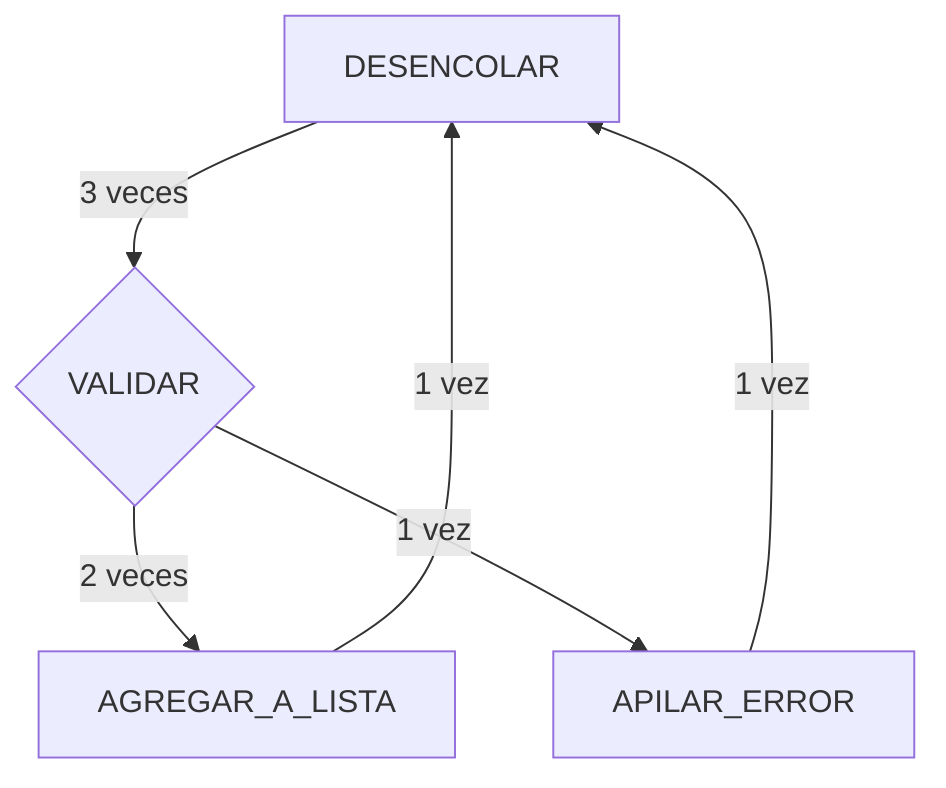

# Flujograma de ejemplo de la bitácora

**Fecha y hora:** 2026-11-15 00:50:01

**Origen:** Generador propio

La prueba registra nueve eventos de ejemplo. VALIDAR tiene dos salidas: agregar el registro a la lista o apilar el error.
