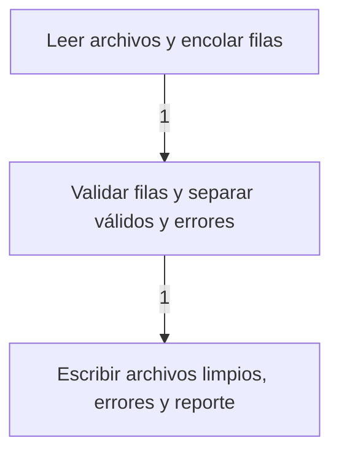

# Reporte del Proceso de Limpieza de Datos del ETL

## 1. Resumen General de Resultados

El proceso de extracción, transformación y carga (ETL) procesó un total de **59 registros** distribuidos en tres archivos de origen. De este conjunto, **50 registros** resultaron válidos, **2 registros** fueron reparados, **2 registros** generaron advertencias y **9 registros** fueron rechazados.

| Archivo           | Leídos | Válidos | Reparados | Con advertencias | Rechazados |
| ----------------- | ------ | ------- | --------- | ---------------- | ---------- |
| **Casos diarios** | 42     | 36      | 0         | 2                | 6          |
| **Condados**      | 9      | 8       | 2         | 0                | 1          |
| **Vecindad**      | 8      | 6       | 0         | 0                | 2          |
| **Total**         | **59** | **50**  | **2**     | **2**            | **9**      |

---

## 2. Desglose Detallado por Archivo

### Casos diarios

- **Registros leídos:** 42
- **Registros válidos:** 36
- **Registros reparados:** 0
- **Registros con advertencias:** 2
- **Registros rechazados:** 6
- `COLUMNAS_INCOMPLETAS`: 1
- `CONDADO_DESCONOCIDO`: 1
- `AREA_SIN_FIPS`: 1
- `VALOR_NO_NUMERICO`: 1
- `VALOR_NEGATIVO`: 1
- `FECHA_INVALIDA`: 1

### Condados

- **Registros leídos:** 9
- **Registros válidos:** 8
- **Registros reparados:** 2
- **Registros con advertencias:** 0
- **Registros rechazados:** 1
- `NO_ES_CONDADO`: 1

### Vecindad

- **Registros leídos:** 8
- **Registros válidos:** 6
- **Registros reparados:** 0
- **Registros con advertencias:** 0
- **Registros rechazados:** 2
- `DUPLICADO`: 1
- `AUTO_VECINDAD`: 1

---

## 3. Información Faltante y Observaciones de Trazabilidad

El resumen entregado no incluye los siguientes datos complementarios del proceso:

- **Detalle de advertencias:** No se especifica el motivo o código de advertencia para los **2 registros** con advertencias en el archivo _Casos diarios_.
- **Detalle de reparaciones:** No se indica qué reglas de transformación o corrección se aplicaron a los **2 registros** reparados en el archivo _Condados_.
- **Inclusión en válidos:** No se explicita si los registros **reparados** (2 en _Condados_) y los registros **con advertencias** (2 en _Casos diarios_) forman parte del conteo de registros **válidos** reportados (8 y 36, respectivamente).
- **Metadatos operativos:** Faltan marcas de tiempo (inicio/fin), duración de ejecución, nombres físicos/rutas de los archivos de entrada y salida, e identificadores de las filas afectadas.

---

## 4. Flujograma del Proceso ETL

